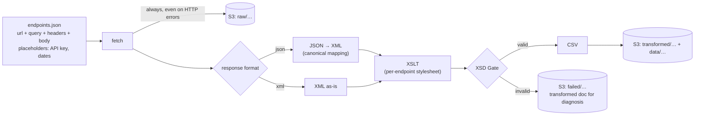

# Universal API → CSV Scraper

A declarative scraper running as an AWS Lambda (Python 3.13 + lxml): every data
source is an entry in `endpoints.json` — request shape, response format, and the
transformation that turns the response into CSV. No endpoint has any code of its
own; the per-source knowledge lives in configuration and an XSLT stylesheet.
Infrastructure is Terraform: a 1-AZ VPC with a fck-nat instance for egress, an
S3 gateway endpoint, and EventBridge Scheduler crons.

## Pipeline



1. **Fetch** — build the declared request, substituting placeholders:
   `${env:NAME}` for any environment variable (secrets — their values never
   land in a stored artifact) and `${date:FORMAT:ISO_DURATION}` for computed
   dates (local midnight of anchor + duration, e.g. `-P1D`, in the endpoint's
   timezone, rendered in UTC). The anchor defaults to today and any run can
   override it, so backfills are the same code path. Transient HTTP failures
   retry with backoff.
2. **Normalize** — XML passes through; JSON is converted to XML by a small
   canonical mapping (`json2xml.py`).
3. **Transform** — the endpoint's XSLT turns the document into a flat table.
   All source-specific knowledge lives in the stylesheet: which elements
   become columns, their names, any computation (e.g. per-point timestamps).
4. **Validate** — the result must pass `schema/table.xsd`, the
   machine-checkable definition of "convertible to CSV" — passing it is what
   certifies the document; rejects are archived instead of producing broken
   output.
5. **Emit** — the certified table becomes CSV under an idempotent date key.

Every artifact is kept, keyed `{id}/{key-date}` (key-date = anchor +
`keyDateOffsetDays`, so re-runs overwrite idempotently): `raw/` exactly as
fetched (archived before any processing, also on failed fetches),
`transformed/` the certified XSLT output, `data/` the CSV, `failed/` documents
the XSD gate rejected. Endpoints are isolated — one failure never blocks the
rest — but any failure fails the invocation so it lands in the Lambda `Errors`
metric.

## Declaring an endpoint

```json
{
  "id": "entsoe-generation-actual-perunit",
  "path": "/api",
  "query": {
    "securityToken": "${env:API_KEY}",
    "documentType": "A73", "processType": "A16",
    "in_Domain": "10YSK-SEPS-----K",
    "periodStart": "${date:%Y%m%d%H%M:-P1D}",
    "periodEnd": "${date:%Y%m%d%H%M:P0D}"
  },
  "responseFormat": "xml",
  "xslt": "entsoe-perunit.xslt",
  "timezone": "Europe/Bratislava",
  "keyDateOffsetDays": -1
}
```

Adding a source = one JSON entry + one stylesheet. `method`/`body` are
supported for POST-style APIs (placeholders apply to the body too); an absolute
`url` bypasses `baseUrl`. The two shipped endpoints scrape the official ENTSO-E
Transparency RESTful API in its **native XML** (`GL_MarketDocument`) — chosen
over the API's JSON rendering deliberately: the XML states value semantics
explicitly (generation vs consumption are separate TimeSeries with explicit
direction elements, and unit names ship in-band), where the JSON rendering
leaves array-slot ordering undocumented. The JSON→XML path is exercised by the
test suite and available to any endpoint that declares `responseFormat: "json"`.

## Repository layout

```
powerex-assignment/
├── src/powerex_scraper/         # engine: config, placeholders, http, json2xml, pipeline, orchestrator, handler
│   ├── endpoints.json           # the declared sources (ships in the zip)
│   ├── xslt/                    # per-endpoint stylesheets
│   └── schema/table.xsd         # the "CSV-able" contract
├── tests/                       # pytest suite + real captured API fixtures (offline)
├── terraform/                   # VPC, fck-nat, S3, IAM, Lambda, EventBridge Scheduler
└── scripts/build.sh             # package + vendored lxml wheel → dist/lambda.zip
```

## Prerequisites

- Python 3.13+ (Test locally below creates a venv and installs the pinned deps)
- Terraform ≥ 1.9; AWS CLI v2 with credentials + region (deploy only)
- An API key for the declared endpoints (for ENTSO-E: a Transparency Platform
  security token) — copy `.env.example` to `.env` (gitignored) and fill it in;
  `source .env` covers both local runs (`API_KEY`) and Terraform
  (`TF_VAR_api_key` → `var.api_key`)
- bash, zip/unzip, git

## Test locally

    python3 -m venv .venv && .venv/bin/pip install -r requirements-dev.txt
    .venv/bin/pytest                    # offline: fixtures + fake transport
    source .env && PYTHONPATH=src python3 -m powerex_scraper --endpoint entsoe-generation-actual-perunit

The local runner writes the same `raw/ data/ failed/` layout to `./out`.

## Deploy runbook

    ./scripts/build.sh                   # → dist/lambda.zip (vendors the Linux/arm64 lxml wheel)
    terraform -chdir=terraform init      # provider versions pinned by the committed lock file
    source .env                          # provides api_key via TF_VAR_api_key
    terraform -chdir=terraform apply
    aws lambda invoke --function-name $(terraform -chdir=terraform output -raw function_name) \
      --cli-binary-format raw-in-base64-out --payload '{}' /tmp/scrape-out.json
    aws s3 ls s3://$(terraform -chdir=terraform output -raw bucket_name)/ --recursive
    terraform -chdir=terraform destroy

Notes: a manual invoke accepts `{"endpointIds":[…],"anchorDate":"yyyy-mm-dd"}`
(`anchorDate` replaces "today" — backfills). `terraform destroy` can
hold 10–20 minutes on Lambda network-interface cleanup — normal, don't
interrupt. First invocation adds a few seconds (cold start + VPC path).

## Trade-offs & Gaps

### API key as a Lambda environment variable. 
Probably should use SSM or something in production.

### XSLT
On one hand, much higher flexibility than some simple configuration, on the other hand much more complex to set up and merges "configuration" and "business logic". Also might be good idea to prove json native transformations instead of converting json to xml.

### No Pagination support
For other datasources pagination or cursor based fetch might be needed.

### Rate limiting
If we were scraping a lot of endpoints we might hit rate limits that would not fail cleanly.

### Schema drift detection
No proactive alerts for schema changes, might be a good idea for production version.

## Costs

| Item | Monthly (≈) |
|---|---|
| fck-nat `t4g.nano` | $3.07 |
| Public IPv4 address | $3.65 |
| EBS gp3 8 GB (NAT root) | $0.64 |
| Lambda / S3 / Scheduler / Logs at this volume | ≈ $0 |
| **Total** | **≈ $7.4/mo — ≈ 1¢/hour** |
